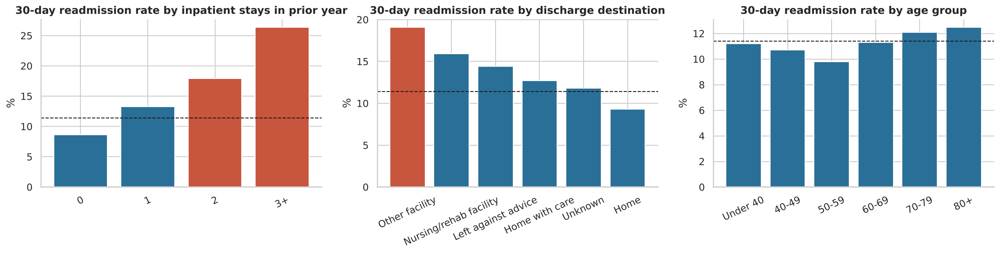

# Hospital Readmission Analysis — 101,766 Real Encounters from 130 US Hospitals

Khushi Balyan

End-to-end healthcare analytics project on a **real, public, de-identified hospital dataset**: raw records → cleaning → analysis in Python and SQL → readmission risk model → interactive dashboard → recommendations for hospital managers.

## Data

*Diabetes 130-US Hospitals for Years 1999–2008* — Clore, J., Cios, K., DeShazo, J., & Strack, B. (2014). UCI Machine Learning Repository. https://doi.org/10.24432/C5230J. Licence: [CC BY 4.0](https://creativecommons.org/licenses/by/4.0/).

101,766 inpatient encounters (71,518 patients) of patients with diabetes at 130 US hospitals, extracted from the Cerner Health Facts database. The raw files are included in `data/raw/` unchanged; the copy was verified against the official row, patient, column and readmission counts.

Source paper: Strack, B. et al. (2014). *Impact of HbA1c Measurement on Hospital Readmission Rates: Analysis of 70,000 Clinical Database Patient Records.* BioMed Research International, 781670.

## Business questions

| # | Question |
|---|---|
| Q1 | How is the hospital network doing at a glance? |
| Q2 | Who is admitted, and how? |
| Q3 | Which patients and conditions stay longer? |
| Q4 | Who is readmitted within 30 days? |
| Q5 | Where do hospital resources (bed-days) go? |

## Key results

| Metric | Value |
|---|---|
| Encounters / patients (after cleaning) | 101,763 / 71,515 |
| Average length of stay | 4.40 days (median 4) |
| 30-day readmission rate | 11.39% (11,314 of 99,340 eligible encounters) |
| HbA1c measured | 16.7% of encounters |
| Total bed-days | 447,352 |

- **Prior inpatient use is the strongest signal:** readmission rises from 8.6% (no inpatient stay in the prior year) to 26.4% (3 or more) — 3× higher.
- **Discharge destination matters:** 15.9% for nursing/rehab facilities and 19.1% for other facilities vs 9.3% for home (adjusted odds ratios 1.67 and 2.24).
- **Diagnosis matters less than expected:** rates range only from 9.5% (musculoskeletal) to 13.1% (diabetes).
- **HbA1c is rarely measured:** 16.7% of encounters; tested patients were readmitted less often (9.9% vs 11.7%, adjusted OR 0.87), consistent with Strack et al.
- **Resource use:** circulatory conditions take 28.8% of all bed-days; readmission stays take 12.1%.
- **Risk model:** gradient boosting with a **patient-grouped** train/test split (no patient in both sets), hold-out AUC 0.663 (logistic regression 0.659). The top-risk 10% are readmitted at 26.0% — 2.3× the base rate — and hold 22.7% of all readmissions.



## Project structure

```
hospital-data-analysis/
├── data/
│   ├── raw/diabetic_data.csv, IDS_mapping.csv     # original UCI files (CC BY 4.0)
│   ├── processed/hospital_encounters_clean.csv    # clean analysis table
│   ├── processed/cleaning_log.csv                 # every cleaning step + row counts
│   ├── processed/summary_*.csv, kpis.json, risk_model.json
│   └── DATA_DICTIONARY.md                         # fields + shared metric definitions
├── scripts/
│   ├── 01_clean_data.py      # cleaning, ID mapping, ICD-9 grouping, readmission flag
│   ├── 02_run_sql.py         # loads SQLite and runs all SQL queries
│   └── build_notebook.py     # rebuilds the notebook from source
├── notebooks/hospital_analysis.ipynb   # full analysis, charts and models (executed)
├── sql/analysis_queries.sql            # 10 queries: CTEs, window functions, ranking
├── powerbi/DAX_measures.dax, BUILD_GUIDE.md   # 20 DAX measures + build guide
├── dashboard/                          # source of the live web dashboard (HTML + D3)
├── reports/figures/                    # charts from the notebook
└── requirements.txt
```

## How to run

```bash
pip install -r requirements.txt
python scripts/01_clean_data.py
python scripts/02_run_sql.py
jupyter notebook notebooks/hospital_analysis.ipynb
```

## Data cleaning highlights

| Issue | Rows | Fix |
|---|---|---|
| "?" used as missing marker | 192,849 cells | Converted to missing values |
| Invalid gender | 3 | Removed |
| Weight / max glucose serum | 96.9% / 94.7% missing | Columns dropped |
| Admitting specialty | 49.1% missing | Grouped as "Not recorded" |
| Admission, source, discharge codes | all | Mapped to labels |
| 716 distinct ICD-9 codes | all | Grouped into 9 categories |
| Repeat patients | 30,248 encounters | Model split grouped by patient |

**Validation:** raw file matches UCI's published counts; KPIs are identical across the notebook, SQL and the dashboard.

## Tools

Python (pandas, NumPy, matplotlib, seaborn, statsmodels, scikit-learn) · SQL (SQLite) · Jupyter · Power BI / DAX · D3.js dashboard · Git

## Limitations

Observational data from 1999–2008 (ICD-9 era); readmissions to hospitals outside the database are probably missed; no cost, dates, severity or social factors; diabetic patients only. Findings are associations, not causes.
