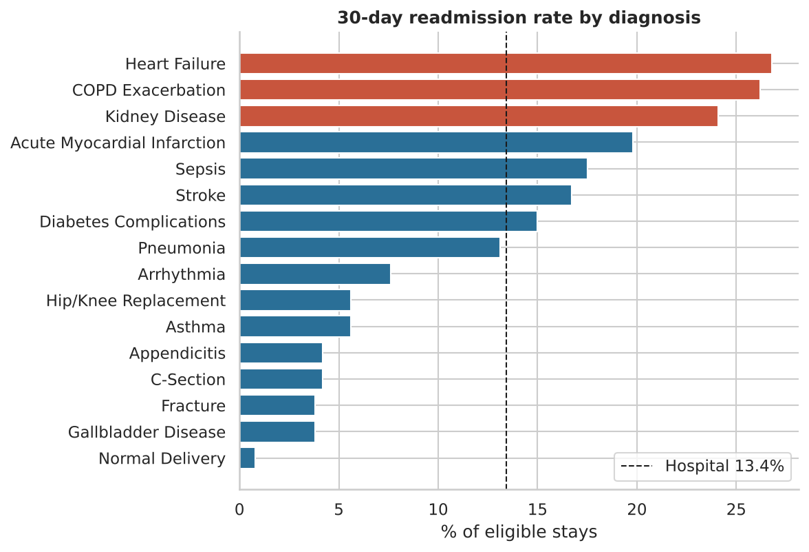

# Hospital Data Analysis & Dashboard

Khushi Balyan 

End-to-end healthcare analytics project: raw, messy hospital admission records → cleaned dataset → analysis in Python and SQL → interactive dashboard → recommendations for hospital managers.

> **Data:** synthetic and fully de-identified (10,209 admissions, 7,200 patients, Jan 2023 – Dec 2024, costs in ₹). No real patient data is used. Findings are patterns in data, not medical advice.


---

## Business questions

| # | Question |
|---|---|
| Q1 | How is the hospital doing at a glance? |
| Q2 | Who is admitted, and when? |
| Q3 | Which patient groups and conditions stay longer? |
| Q4 | Which patients are more likely to be readmitted within 30 days? |
| Q5 | Which departments, conditions and admission types cost the most? |

## Key results

| Metric | Value |
|---|---|
| Admissions / patients | 10,209 / 7,200 |
| Average length of stay | 6.37 days (median 5) |
| 30-day readmission rate | 13.4% (1,264 of 9,412 eligible stays) |
| Average cost per stay | ₹1,08,971 |
| Total cost | ₹109.58 crore |

- **Age drives length of stay:** 80+ patients stay 10.9 days vs 3.9 for ages 18–34.
- **Chronic conditions drive readmissions:** heart failure 26.8%, COPD 26.2%, kidney disease 24.1% — about 2× the hospital rate.
- **History predicts return:** patients with 3+ admissions in the prior year are readmitted at 38.5% vs 10.4% for first-timers.
- **Leaving against medical advice** nearly triples readmission odds (adjusted OR 2.89).
- **Cost concentration:** Cardiology + Orthopedics = 48% of spend; the top 10% of stays = 26.6%.
- **Risk model:** logistic regression, hold-out AUC 0.75; the top-risk decile is readmitted at 41.8% and holds 31% of all readmissions.



## Project structure

```
hospital-analytics/
├── data/
│   ├── raw/hospital_admissions_raw.csv        # messy generated data (10,362 rows)
│   ├── processed/hospital_admissions_clean.csv # clean analysis table (10,209 rows)
│   ├── processed/cleaning_log.csv              # every cleaning step + row counts
│   ├── processed/summary_*.csv, kpis.json      # outputs used by the report/dashboard
│   └── DATA_DICTIONARY.md                      # fields + shared metric definitions
├── scripts/
│   ├── 01_generate_data.py   # synthetic data with realistic patterns + injected errors
│   ├── 02_clean_data.py      # cleaning + feature engineering
│   ├── 03_run_sql.py         # loads SQLite, runs all SQL queries
│   └── build_notebook.py     # rebuilds the notebook from source
├── notebooks/hospital_analysis.ipynb   # full analysis with charts (executed)
├── sql/analysis_queries.sql            # 10 queries: CTEs, window functions, ranking
├── powerbi/
│   ├── DAX_measures.dax      # 25 measures + Calendar table
│   └── BUILD_GUIDE.md        # page-by-page Power BI build + validation targets
├── dashboard/                # source of the live web dashboard (HTML + D3)
├── reports/figures/          # PNG charts from the notebook
└── requirements.txt
```

## How to run

```bash
pip install -r requirements.txt
python scripts/01_generate_data.py
python scripts/02_clean_data.py
python scripts/03_run_sql.py
jupyter notebook notebooks/hospital_analysis.ipynb
```

## Data cleaning highlights

| Issue | Rows | Fix |
|---|---|---|
| Duplicate records | 153 | Removed |
| Inconsistent gender labels | 1,033 | Standardised |
| Inconsistent department names | 351 | Mapped to 9 standard names |
| Mixed date formats | 510 | Converted to ISO |
| Discharge before admission | 15 | Swapped back |
| Missing / impossible ages | 216 | Imputed and flagged |
| Costs stored as text | 408 | Parsed |
| Mis-keyed cost outliers | 8 | Corrected and flagged |
| Missing cost | 153 | Kept missing; excluded from cost metrics |

**Validation:** KPIs match exactly across the notebook, SQL and the dashboard; the readmission flag was derived independently in pandas and SQL (1,264 = 1,264).

## Tools

Python (pandas, NumPy, matplotlib, seaborn, statsmodels, scikit-learn) · SQL (SQLite) · Jupyter · Power BI / DAX · D3.js dashboard · Git

## Limitations

Synthetic data; associations not causes; readmissions only counted at this hospital; 2024's higher volume partly reflects repeat visits accumulating, not real growth.

---

## Resume bullets (pick 2–4)

- Built an end-to-end hospital analytics project in **Python and SQL** on 10,000+ de-identified admissions, analysing length of stay, 30-day readmissions and cost across 9 departments and 16 diagnoses.
- Designed a reproducible **pandas cleaning pipeline** that resolved 10 data-quality issues (duplicates, mixed date formats, inconsistent labels, invalid ages, text-formatted costs) with a full audit log and data dictionary.
- Identified that 3 chronic conditions are readmitted at ~2× the hospital average and that patients with 3+ prior admissions return at 38.5% vs 10.4%, leading to a targeted discharge follow-up recommendation.
- Built a **logistic-regression readmission risk model** (hold-out AUC 0.75) whose top-risk decile captured 31% of readmissions at 3× the base rate.
- Developed an **interactive dashboard** (KPI cards, filters, 6 charts) and a **Power BI build kit with 25 DAX measures**; validated that every KPI matched the SQL and Python results exactly.
- Wrote **10 SQL queries** using CTEs and window functions (LEAD, RANK) to compute KPIs and independently re-derive the readmission flag.
